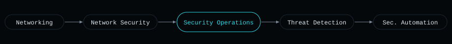
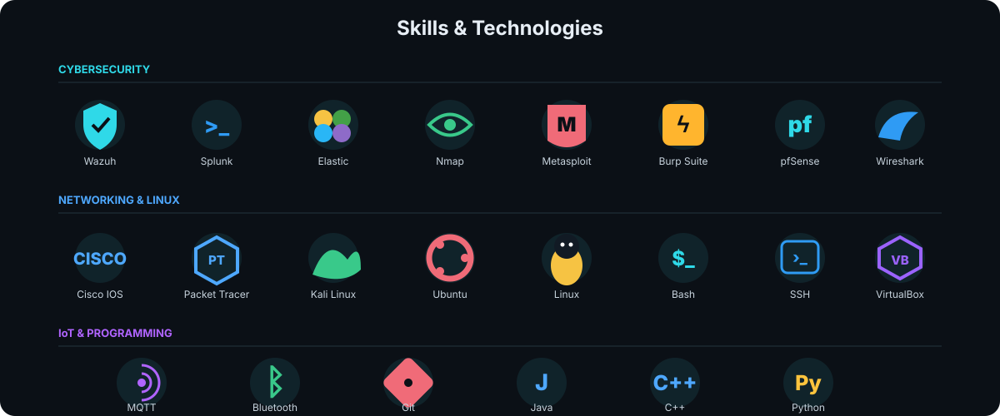
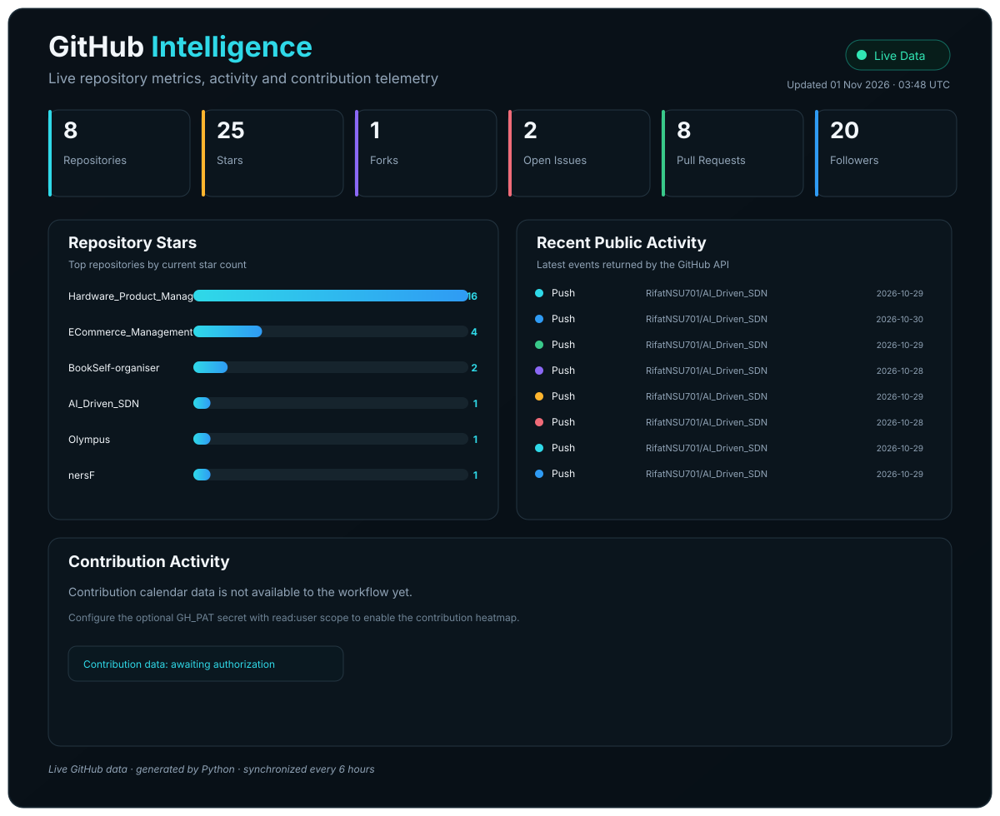
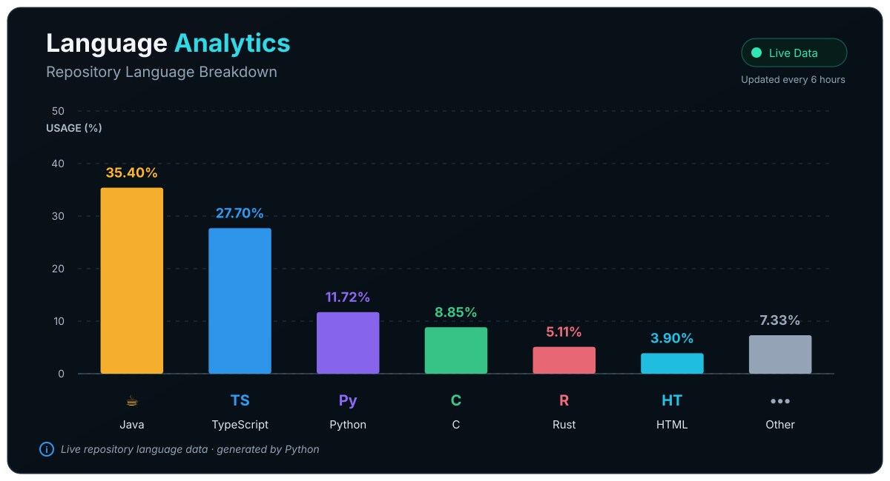
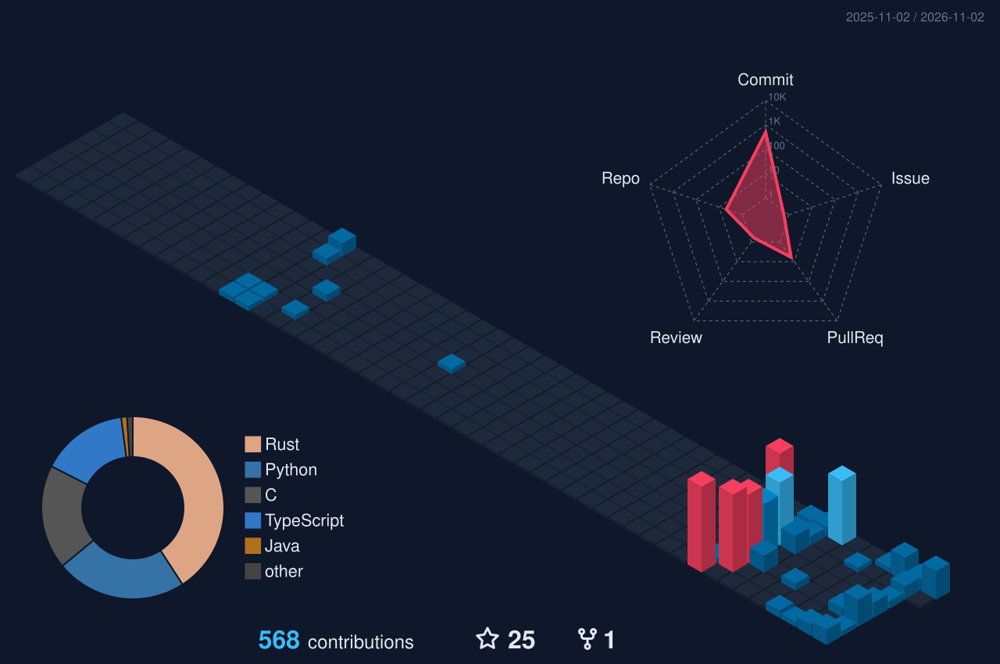
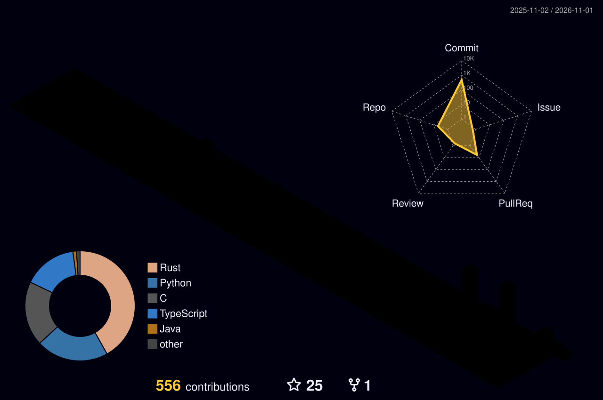
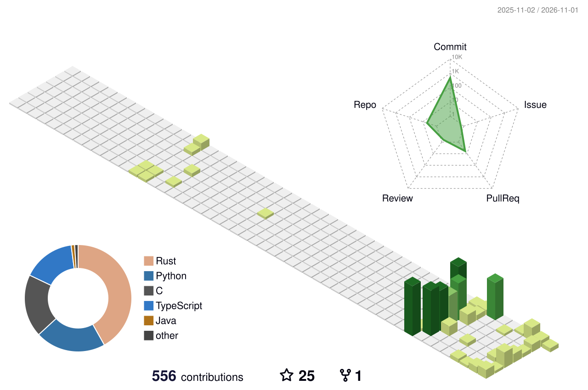

<!-- ===================================================================== -->
<!-- 1. HERO BANNER (LOCAL AUTO-SYNCED SVG)                                -->
<!-- ===================================================================== -->
<picture>
  <source media="(prefers-color-scheme: dark)" srcset="./assets/hero.svg" />
  <source media="(prefers-color-scheme: light)" srcset="./assets/hero.svg" />
  
</picture>

 

<!-- ANIMATED TYPING HEADER -->

 

<!-- ===================================================================== -->
<!-- 2. ANIMATED INTERACTIVE PORTFOLIO BUTTON -> https://www.rifatkhan.tech/ -->
<!-- ===================================================================== -->

  

<!-- ===================================================================== -->
<!-- 3. LIVE SYNCHRONIZED TELEMETRY & SOCIAL COMMAND BAR                   -->
<!-- ===================================================================== -->

  
  
  
  

  
  
  
  
  

---

## 🎯 Executive Mission & Systems Architecture

  

---

## 🛡️ Complete Technical Arsenal & Multi-Domain Skill Matrix

### 1️⃣ Cybersecurity, SIEM & Network Defense Toolchain (Local Verified Assets)

  

 

<table>
  <thead>
    <tr>
      <th align="center">Offensive Security &amp; Recon</th>
      <th align="center">SIEM, SOC &amp; Threat Intelligence</th>
      <th align="center">Network Architecture &amp; Firewalls</th>
      <th align="center">Systems &amp; Hardened Environments</th>
    </tr>
  </thead>
  <tbody>
    <tr>
      <td align="center" width="25%">
        &nbsp;&nbsp;
        &nbsp;&nbsp;
        &nbsp;&nbsp;
        
         
        <b>Kali • Burp Suite • Metasploit • Nmap</b>
      </td>
      <td align="center" width="25%">
        &nbsp;&nbsp;
        &nbsp;&nbsp;
        &nbsp;&nbsp;
        
         
        <b>Splunk • Wazuh • Elastic SIEM • Wireshark</b>
      </td>
      <td align="center" width="25%">
        &nbsp;&nbsp;
        &nbsp;&nbsp;
        &nbsp;&nbsp;
        
         
        <b>pfSense • Cisco • Packet Tracer • OpenSSH</b>
      </td>
      <td align="center" width="25%">
        &nbsp;&nbsp;
        &nbsp;&nbsp;
        
         
        <b>Linux Kernel • Ubuntu Server • Bash</b>
      </td>
    </tr>
  </tbody>
</table>

### 2️⃣ Core Programming, Full-Stack Engineering, Data & Cloud Ecosystem

| Domain | Technologies & Engineering Stack |
| :--- | :--- |
| **💻 Core Languages** |         |
| **📱 Web & Mobile Apps** |       |
| **📊 Data, Databases & AI** |      |
| **☁️ Cloud, DevOps & Tools** |       |

 

### 3️⃣ Live Telemetry Skill Dashboards

  
    
  

---

## 🏅 Certifications & Verified Credentials

  

  
<b>🪪 Flip Certificate Card (View Details &amp; Verification)</b>

   
  

    
  

---

## 📈 Live Developer Telemetry & Dynamic Graphs

  <!-- LOCAL AUTO-SYNCED GITHUB INTELLIGENCE SVG -->
  
    

  <!-- LOCAL AUTO-SYNCED LANGUAGE ANALYTICS SVG -->
  
    

  <!-- STREAK TELEMETRY & OVERALL PROFILE SUMMARY -->
  
  

    

  <!-- REPO LANGUAGES, COMMIT LANGUAGES & PRODUCTIVE TIME (UTC +6.00) -->
  
  
  

---

## 🌐 3D Contribution Telemetry & Autonomous Snake Grid

  <!-- PRIMARY CUSTOM TOKYONIGHT 3D CONTRIBUTION GRAPH -->
  

  
<b>🎨 Switch 3D Contribution Telemetry Theme (Night-Rainbow / Matrix Green / GitBlock)</b>

   
  

    
    
  

 

### 🐍 Autonomous Contribution Snake Game

  <picture>
    <source media="(prefers-color-scheme: dark)" srcset="https://raw.githubusercontent.com/RifatNSU701/RifatNSU701/output/github-contribution-grid-snake-dark.svg" />
    <source media="(prefers-color-scheme: light)" srcset="https://raw.githubusercontent.com/RifatNSU701/RifatNSU701/output/github-contribution-grid-snake.svg" />
    
  </picture>

 

  

